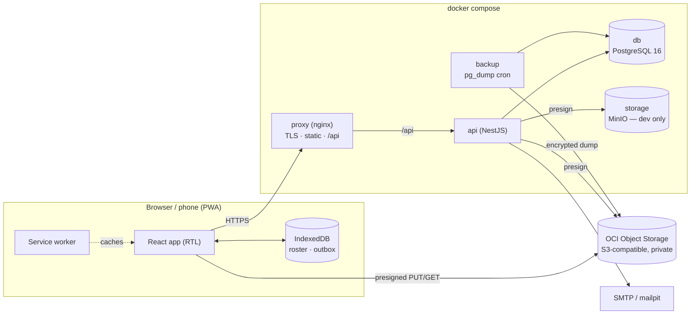
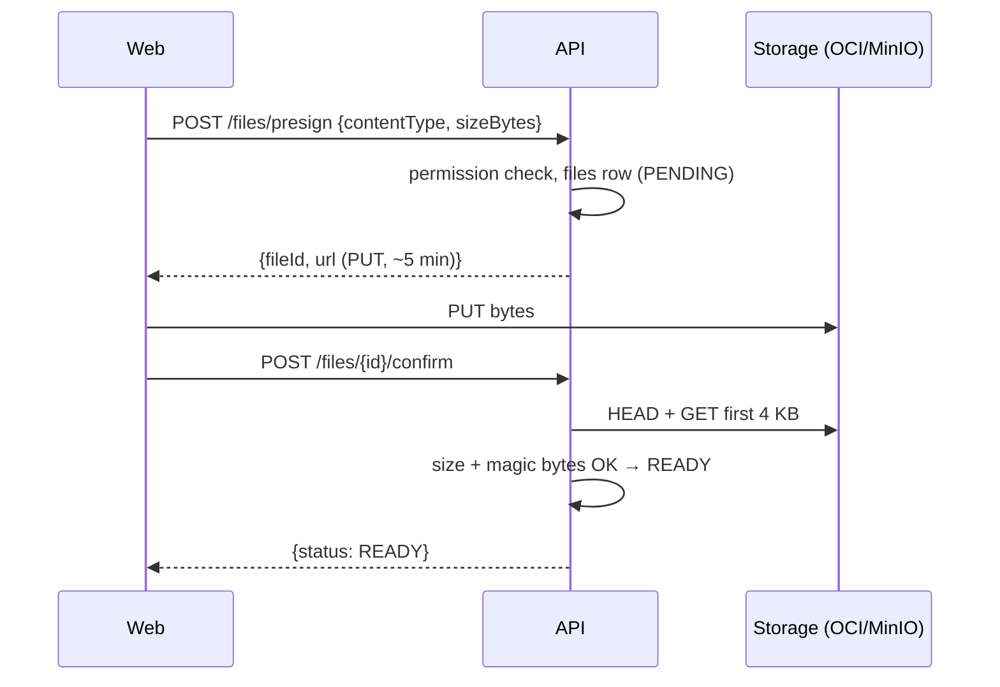
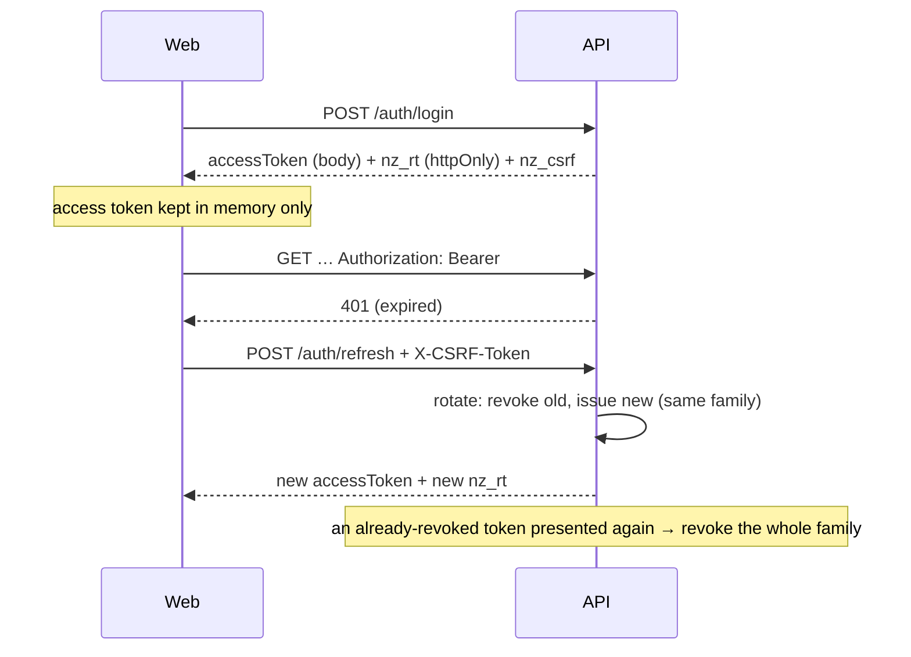
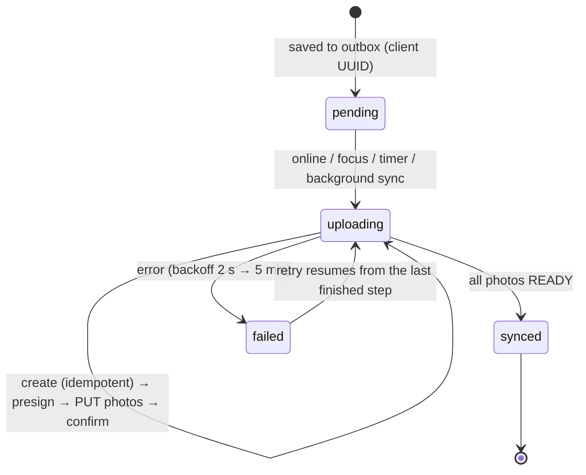

# Architecture

## Repository tree

```
.
├── PROMPT.md                     living brief (§18 = amendments log)
├── CLAUDE.md                     working rules for coding agents
├── docker-compose.yml            proxy · api · db · backup
├── docker-compose.dev.yml        + minio · mailpit · hot reload
├── docker-compose.prod.yml       no minio, limits, restart policies
├── .env.example
├── apps/
│   ├── api/                      NestJS 10 + Prisma 5
│   │   ├── prisma/
│   │   │   ├── schema.prisma
│   │   │   └── migrations/       generated SQL + raw-SQL constraints
│   │   ├── src/
│   │   │   ├── main.ts
│   │   │   ├── common/           error filter, zod pipe, guards, decorators
│   │   │   ├── config/           env schema
│   │   │   ├── prisma/
│   │   │   ├── crypto/           national-ID encryption + blind index
│   │   │   ├── auth/             login, refresh rotation, reset, CSRF
│   │   │   ├── users/            users + registrations + last-admin
│   │   │   ├── audit/
│   │   │   ├── notifications/    in-app + email
│   │   │   ├── settings/
│   │   │   ├── storage/          S3/OCI presign + confirm + magic bytes
│   │   │   ├── teams/ members/ reference/ cards/        (phase 2)
│   │   │   ├── violations/                               (phase 3)
│   │   │   ├── projects/ tasks/ calendars/               (phase 4)
│   │   │   └── seed/
│   │   ├── test/int/             Testcontainers integration tests
│   │   └── Dockerfile
│   └── web/                      React 18 + Vite + Mantine (RTL)
│       ├── src/
│       │   ├── api/              ApiClient · HttpApi · demo/DemoApi
│       │   ├── app/              router, shell, nav registry, guards
│       │   ├── features/         one folder per module
│       │   ├── i18n/             ar.ts (complete) · en.ts (scaffold)
│       │   ├── theme/            tokens.css + Mantine theme
│       │   └── components/       VestBand, TeamBadge, …
│       ├── scripts/check-i18n.mjs
│       └── Dockerfile            builds web, ships nginx
├── packages/
│   ├── shared/                   zod schemas, DTO types, permissions, validators, errors
│   ├── scheduling/               pure TS Gantt engine
│   └── ui-print/                 card templates (mm units)
├── seed/demo/                    demo data only — replaced by the owner's data
├── infra/
│   ├── nginx/                    TLS, SPA, /api proxy, headers
│   ├── backup/                   pg_dump cron + restore.sh
│   └── certs/                    mkcert (dev) / provided certs (prod)
├── e2e/                          Playwright (mobile + desktop)
├── docs/                         ADRs, phases, printing, offline, OCI, backup
└── .github/workflows/            ci.yml · pages.yml
```

## Runtime



## Upload flow (brief §3.2)



## Auth flow (ADR-010)



## Offline violation sync (brief §7.4)



## The demo build (ADR-020)

GitHub Pages hosts `apps/web` built with `--mode demo`. The `ApiClient` interface is implemented by `DemoApi`, which keeps all data in the browser and applies the same zod schemas, permission matrix and business rules as the API. Nothing leaves the browser.
