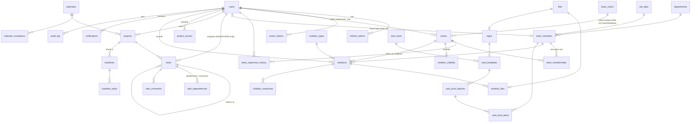

# Data model

Source of truth: `apps/api/prisma/schema.prisma` plus the raw-SQL constraints in `apps/api/prisma/migrations/20261011000100_constraints/migration.sql` and, since A12, `20261023000000_a12_workspaces/migration.sql` (workspaces, RLS, guards).

## A12 — workspaces (ADR-142..147, `docs/a12-isolation-design.md`)

- **Global (identity/session):** `users` (+ `username` unique lower-case, `account_role` OWNER|USER, `requested_workspace_id`; `role` is legacy and unread), `refresh_tokens` (+ `workspace_id` of the session), `action_tokens`, **`workspaces`** (`id, name, code UNIQUE, status ACTIVE|ARCHIVED, archived_at`), **`workspace_memberships`** (`workspace_id, user_id, role ADMIN|ASSISTANT|SUPERVISOR|MONITOR|MEMBER, title, permissions, scope, status, archived_at`; unique (workspace, user, role)).
- **Every other table (45) is workspace-scoped:** `workspace_id NOT NULL` (FK `ON DELETE RESTRICT`, index, `DEFAULT nz_current_workspace()`), Row Level Security ENABLE + FORCE with the policy `workspace_id = nz_current_workspace() OR nz_rls_bypass()`, and the guard trigger `nz_same_workspace_trg`. NULL allowed only in `audit_log` (account-level entries) and `files` (user profile photos).
- **Unique per workspace:** colour hex, team-colour reservation, department / job title / portfolio / violation type / card size names, worker national ID hash, settings key, default logo / template / calendar, org-unit code, view preferences.
- The first workspace is «إدارة المشاريع» (code `projects`); the A12 migration moved every existing row into it and verified the per-table counts.
- **A12 round 2** (`20261024000000_a12_round2`, ADR-148..152): **`project_participants`** (`project_id, user_id` PK, `workspace_id`, `title` منصب, `level EDITOR|CONTRIBUTOR|VIEWER`, `added_by`) — user must be a member of the workspace (trigger); **`member_requests`** (`id, workspace_id, team_id, member_id?, kind ADD|REMOVE, status PENDING|APPROVED|REJECTED, payload` (masked ID only — CHECK refuses a full ID), `national_id_enc` (AES-GCM, pending ADD only, cleared on decision), `reason, decision_reason, requested_by, decided_by, decided_at`; one pending REMOVE per member); **`projects.cover_file_id`** → `files` (same workspace; `files.entity_type = 'project_cover'`). `workspace_memberships.permissions/scope` now hold an assistant's modules and project/team scope. 47 workspace-scoped tables.

## ERD

## Invariants enforced by the database

| Rule | Brief | Mechanism |
|---|---|---|
| A colour is used by at most one ACTIVE or PENDING_APPROVAL team | §5.2 | partial unique index `teams_color_reserved_uq` |
| A member has exactly one open membership | §5.3 | partial unique index `team_memberships_one_open_uq` |
| Membership intervals never overlap | §5.3, §7.3 | exclusion constraint (btree_gist on `tstzrange`) |
| One open supervisor-history row per team | §5.3 | partial unique index |
| Tasks are assigned to supervisors only — A12: a SUPERVISOR **membership of the task's workspace** | §1, §11 | trigger `tasks_assignee_supervisor_trg` + service check |
| Team leader is a supervisor — A12: of the team's workspace | §4.1 | triggers `teams_supervisor_role_trg`, `team_supervisors_role_trg` |
| A12: a row never references a row of another workspace; `workspace_id` never changes | A12 | constraint trigger `nz_same_workspace_trg` (55 reference columns), `nz_files_entity_workspace_trg` |
| A12: position holders and project access are members of the workspace | A12 | constraint triggers `org_positions_holder_user_ws_trg`, `project_access_user_ws_trg` |
| A12: a business row is visible only in its workspace | A12 | RLS (ENABLE + FORCE) on 45 tables; API role `nuzli_app` |
| A dependency never links a task to itself | §11 | CHECK |
| Unique (predecessor, successor) | §11 | unique index |
| Milestones have zero duration; progress 0–100 | §6.1 | CHECK |
| A cancelled violation has a reason | §7.3 | CHECK |
| Violation creation is idempotent | §7.4 | unique `client_uuid` |
| Print batch creation is idempotent | §12 | unique `idempotency_key` |
| National ID unique (users: global; workers: per workspace since A12) | §4.2 | unique HMAC blind index |
| Audit log is append-only | §13 | trigger rejecting UPDATE/DELETE |
| One default logo / template / calendar | §8.2 | partial unique indexes |

## Invariants enforced by the service layer

- At least one active admin **per workspace** (ADR-009; A12 per workspace).
- A12: every query on a business table is filtered by the active workspace (scoping layer, ADR-143).
- Violation snapshot of team and supervisor at `captured_at` (ADR-014).
- Monitor edit window after sync (setting, default 15 minutes).
- Supervisor violation visibility: global setting + per-team override (§7.6).
- Optimistic concurrency on tasks (`version`, ADR-017).

## Personal data

| Column | Protection |
|---|---|
| `users.national_id_enc`, `team_members.national_id_enc` | AES-256-GCM, key from env (ADR-011) |
| `*.national_id_hash` | HMAC-SHA256 blind index, unique |
| `*.national_id_first`, `*_last2` / `*_last4` | clear, only for masking and on-device search |
| ID-card photos | private bucket, presigned GET (short TTL), every view audited |
