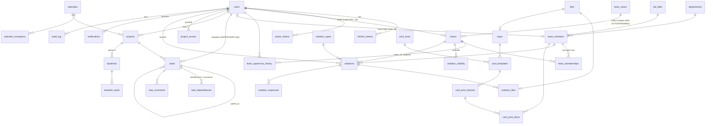

# Data model

Source of truth: `apps/api/prisma/schema.prisma` plus the raw-SQL constraints in `apps/api/prisma/migrations/20261011000100_constraints/migration.sql`.

## ERD

## Invariants enforced by the database

| Rule | Brief | Mechanism |
|---|---|---|
| A colour is used by at most one ACTIVE or PENDING_APPROVAL team | §5.2 | partial unique index `teams_color_reserved_uq` |
| A member has exactly one open membership | §5.3 | partial unique index `team_memberships_one_open_uq` |
| Membership intervals never overlap | §5.3, §7.3 | exclusion constraint (btree_gist on `tstzrange`) |
| One open supervisor-history row per team | §5.3 | partial unique index |
| Tasks are assigned to supervisors only | §1, §11 | trigger `tasks_assignee_supervisor_trg` + service check |
| Team leader is a supervisor | §4.1 | trigger `teams_supervisor_role_trg` |
| A dependency never links a task to itself | §11 | CHECK |
| Unique (predecessor, successor) | §11 | unique index |
| Milestones have zero duration; progress 0–100 | §6.1 | CHECK |
| A cancelled violation has a reason | §7.3 | CHECK |
| Violation creation is idempotent | §7.4 | unique `client_uuid` |
| Print batch creation is idempotent | §12 | unique `idempotency_key` |
| National ID unique | §4.2 | unique HMAC blind index |
| Audit log is append-only | §13 | trigger rejecting UPDATE/DELETE |
| One default logo / template / calendar | §8.2 | partial unique indexes |

## Invariants enforced by the service layer

- At least one active admin (ADR-009).
- Violation snapshot of team and supervisor at `captured_at` (ADR-014).
- Monitor edit window after sync (setting, default 15 minutes).
- Supervisor violation visibility: global setting + per-team override (§7.6).
- Optimistic concurrency on tasks (`version`, ADR-017).

## Personal data

| Column | Protection |
|---|---|
| `users.national_id_enc`, `team_members.national_id_enc` | AES-256-GCM, key from env (ADR-011) |
| `*.national_id_hash` | HMAC-SHA256 blind index, unique |
| `*.national_id_first`, `*_last2` / `*_last4` | clear, only for masking and on-device search |
| ID-card photos | private bucket, presigned GET (short TTL), every view audited |
